  
  
  
  

  
  
  

<i>Just building things, exploring tech, and drinking coffee.</i>

  I build web applications and work with data, mainly with .NET (C#), PHP/Laravel, and JavaScript/React. 
  Previously interned at Bank Indonesia (Data), Balai Bahasa Riau (Web Developer), and PT Kilang Pertamina Internasional RU II Dumai (Software Engineer).

---

### `~/now`

| Building | Status | Stack |
| --- | --- | --- |
| [ScapeGIS](https://github.com/LeebSite/ScapeGIS) — SaaS WebGIS and Spatial AI for property developers | In progress | Next.js, FastAPI, PostGIS, Gemini |
| [Inventara](https://github.com/LeebSite/Inventara) — Asset and inventory management | In progress | .NET 10, ASP.NET Core, SQL Server, Docker |
| [LeebLabs Studio](https://github.com/LeebSite/LeebLabs-Studio) — AI studio for teachers and sellers | In progress | React, TypeScript, Vite |

### `~/exploring`

- **Spatial AI with Gemini** — reasoning over maps and property data in ScapeGIS
- **.NET 10** — clean architecture, testing, and shipping Inventara properly
- **Data and dashboards** — SQL, Python, and Power BI, from raw data to something people can read
- **WebGIS and PostGIS** — spatial queries, layers, and maps that actually load fast

---

### `~/stack`

**Languages &amp; Frameworks**

  

**Data**

  
  
  
  
  
  

**Tools &amp; Platforms**

  

  
  

---

### `~/projects`

| Project | What it is | Stack |
| --- | --- | --- |
| [ScapeGIS](https://github.com/LeebSite/ScapeGIS) | WebGIS and Spatial AI for property developers | Next.js, FastAPI, PostGIS, Gemini |
| [Inventara](https://github.com/LeebSite/Inventara) | Asset and inventory management | .NET 10, ASP.NET Core, SQL Server |
| [LeebLabs Studio](https://github.com/LeebSite/LeebLabs-Studio) | AI studio for teachers and sellers | React, TypeScript, Vite |
| [SIMIT](https://github.com/LeebSite/SIMIT) | Internship information system, built at Pertamina RU II Dumai | ASP.NET Core, SQL Server |

---

### `~/analytics`

  

<table>
  <tr>
    <td valign="top" width="50%">
      
    </td>
    <td valign="top" width="50%">
      
    </td>
  </tr>
</table>

<table>
  <tr>
    <td valign="top" width="33%">
      
    </td>
    <td valign="top" width="33%">
      
    </td>
    <td valign="top" width="33%">
      
    </td>
  </tr>
</table>

  

---

### `~/contributions`

---

  
  
  
  

